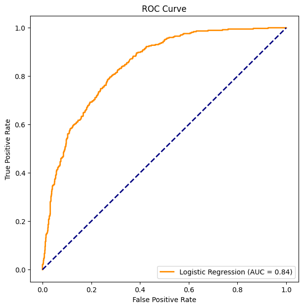
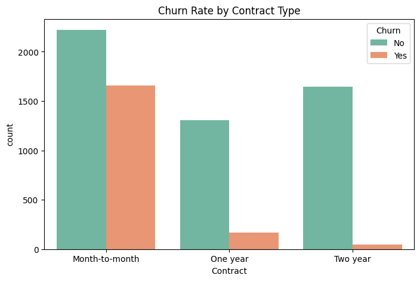

# Telco Customer Churn & Revenue Retention Analysis

An end-to-end predictive analytics and data science project utilizing **Python** and **Machine Learning** to identify primary drivers of customer turnover and protect recurring corporate revenue structures.

📄 **[Read the Full Business Requirements Document (BRD)](docs/BRD_Churn_Retention.md)**

## 📁 Repository Structure
* `data/` - Holds raw source dataset (`WA_Fn-UseC_-Telco-Customer-Churn.csv`)
* `notebooks/` - Contains the explanatory analysis and machine learning scripts
* `images/` - Exported high-impact visualization charts and evaluation curves
* `docs/` - Contains the comprehensive executive business report (BRD)
* `requirements.txt` - Python package dependency configuration list

## 📊 System Performance Metrics
Our optimized predictive engine utilizes a standardized, feature-scaled Logistic Regression framework to isolate and classify customer behavioral profiles:
* **Model Prediction Accuracy:** 80.55%
* **Model ROC-AUC Score:** 0.8423

## 💰 Key Business Insights & Financial Impact
An evaluation of our customer base reveals an **Overall Churn Rate of 26.54%**, creating an immediate drain on corporate cash flow structures:
* **Monthly Revenue Lost to Active Churn:** \$139,130.85
* **Annualized Revenue Lost to Active Churn:** \$1,669,570.20

### Top Customer Retention Drivers:
1. **Two-Year Contracts (`Contract_Two year`: -1.32)**: The absolute strongest preventative anchor. Transitioning customers from unstable month-to-month terms to fixed 2-year terms drastically mitigates corporate revenue risk.
2. **Onboarding Tenure Lifecycle (`tenure`: -1.26)**: High churn density is heavily concentrated within the first 10 months of sign-up. Customers surviving the initial lifecycle window exhibit strong long-term brand loyalty.
3. **Fiber Optic Service Delivery Friction (`InternetService_Fiber optic`: +1.13)**: Fiber optic subscribers exhibit a disproportionately high risk of churning, highlighting potential service delivery defects or pricing friction.

## 🛠️ How to Run the Environment Locally
1. Clone this repository to your system workspace.
2. Install dependencies: `pip install -r requirements.txt`
3. Launch the server workspace: `python -m notebook`

